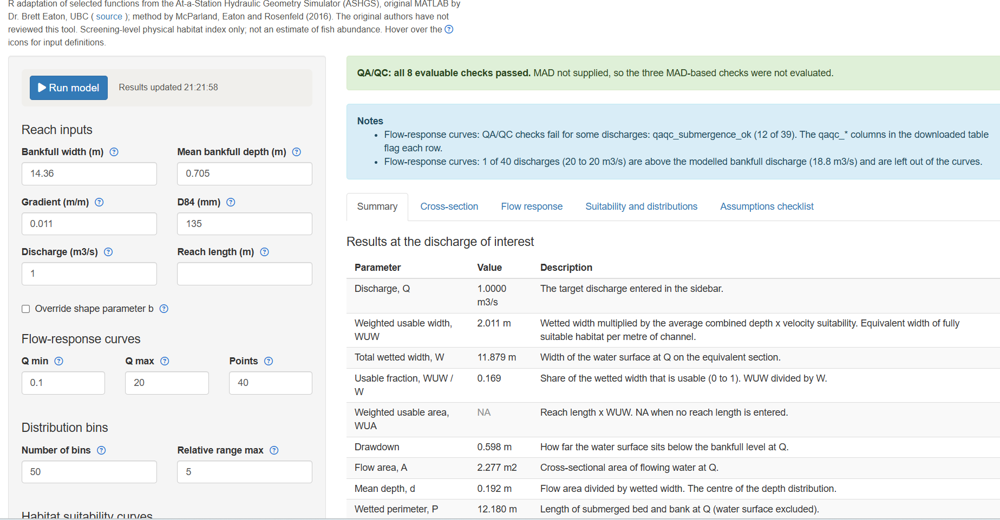
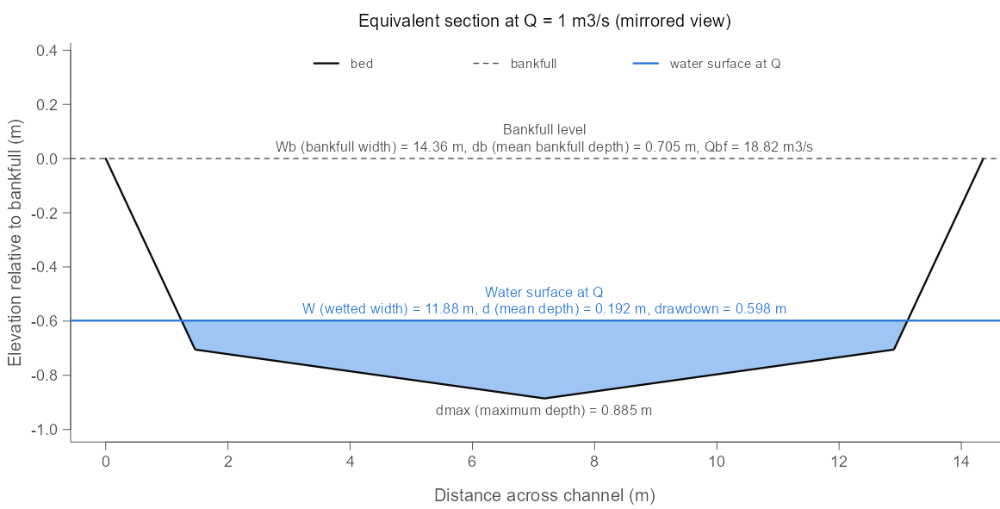
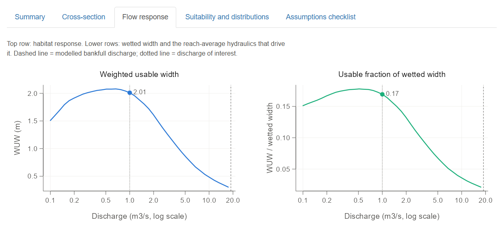
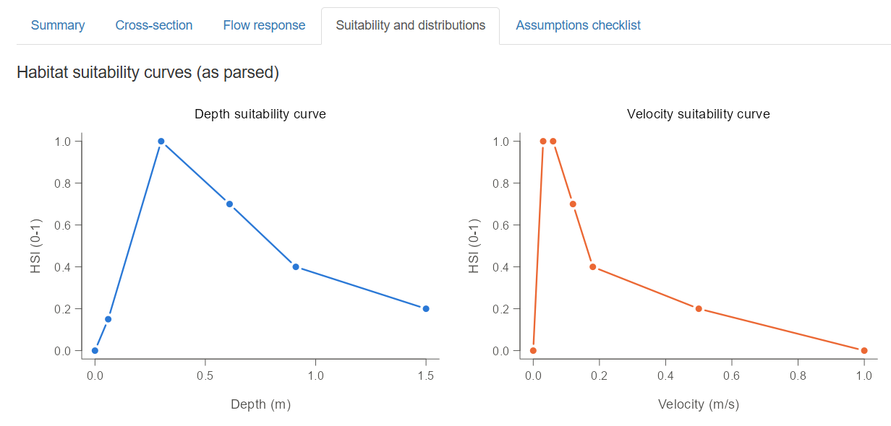

# ashgswuw

**Live app:** <https://01a13ddc-b79e-2928-4786-df71a8d13b5f.share.connect.posit.cloud/>

> **Attribution.** This package is an R adaptation of *selected functions* from
> the **At-a-Station Hydraulic Geometry Simulator (ASHGS)**, originally written
> in MATLAB by **Dr. Brett Eaton** (Department of Geography, University of
> British Columbia) and distributed with the UBCRM-ASHGS tools under GPL-3 at
> <https://blogs.ubc.ca/beaton/working-code/>. The method is described in
> McParland, Eaton and Rosenfeld (2016). Only the hydraulic-geometry and habitat
> (WUA) components were adapted; the UBC Regime Model, sediment-transport and
> plotting code were not. Several deliberate corrections were made during the
> adaptation (corrected geometry, resistance ratio, lognormal parameters and
> exact section clipping), so results
> from this package are **not** an exact reproduction of the original MATLAB
> output. Full credit for the method and the original code belongs to Daniel
> McParland, Brett Eaton and Jordan Rosenfeld. **They have not seen, reviewed
> or endorsed this package**, and any errors in the adaptation are the package
> author's alone. Please cite both the original source and the paper when
> using it.


Simplified estimates for weighted usable width (WUW, m) and weighted usable area (WUA, m²) of fish
habitat at a chosen discharge, from reach-average channel inputs rather than a
surveyed cross-section.

The package implements the hydraulic and habitat components of ASHGS,
supplying bankfull geometry directly. It is a screening tool for comparing
physical habitat across flows in single-thread, alluvial gravel-bed channels.
It is not a spatial hydraulic model and it does not estimate fish numbers.
It is also not a replacement for conventional instream flow studies with appropriate design and monitoring standards.
The functions here provide only very coarse approximations for larger spatial models.

Model label: **ASHGS direct-geometry pathway (R adaptation)**, version string
from `model_version()`.

## Installation

```r
# from the project directory containing ashgswuw/
devtools::install("ashgswuw")
```

Base R only (`stats`, `utils`). R >= 4.1.

## Inputs

| Argument | Units | Notes |
|---|---|---|
| `bankfull_width_m` | m | Bankfull width |
| `bankfull_depth_m` | m | **Mean** bankfull depth (area / width), not maximum depth |
| `gradient_m_per_m` | m/m | Rise over run. 1.1 % is `0.011`. A warning is issued above 0.2 |
| `d84_mm` | mm | Bed-surface grain size than which 84 % is finer |
| `discharge_m3s` | m³/s | Target discharge, `0 < Q <= modelled bankfull Q` |
| `depth_hsi`, `velocity_hsi` | m, m/s; HSI 0-1 | Two-column data frames, see below |
| `reach_length_m` | m | Optional. Enables WUA |
| `n_bins`, `rel_max` | - | Bin count and relative range (defaults 50 and 5, as in the paper) |
| `b` | - | Optional shape parameter overriding `(Wb / db) / 100` |

HSI tables have a variable column (`depth` or `velocity`) and an `hsi` column;
unnamed columns are read positionally. `prepare_hsi()` drops incomplete rows,
clamps HSI to 0-1, sorts and de-duplicates. Curves are interpolated linearly
and **held flat beyond their documented range**.

```
velocity,hsi        depth,hsi
0,0                 0,0
0.03,1              0.06,0.15
0.06,1              0.3,1
0.12,0.7            0.61,0.7
0.18,0.4            0.91,0.4
```

## Example

```r
library(ashgswuw)

depth_hsi    <- read.csv(system.file("extdata", "hsi_example_depth.csv",    package = "ashgswuw"))
velocity_hsi <- read.csv(system.file("extdata", "hsi_example_velocity.csv", package = "ashgswuw"))

# Harris Creek, BC (McParland et al. 2016). The example curves are illustrative only.
res <- wuw_estimate(bankfull_width_m = 14.36, bankfull_depth_m = 0.705,
                    gradient_m_per_m = 0.011, d84_mm = 135,
                    discharge_m3s = 1,
                    depth_hsi = depth_hsi, velocity_hsi = velocity_hsi,
                    reach_length_m = 150)
res
#> ashgswuw 0.1.0 / ASHGS direct-geometry pathway
#> Geometry: b = 0.2037 (estimated), dmax = 0.885 m, bankfull area = 10.124 m2, bankfull Q = 18.816 m3/s
#> At Q: drawdown = 0.598 m, wetted width = 11.879 m, mean depth = 0.192 m, velocity = 0.439 m/s, Fr = 0.320, Smix = 0.185
#> WUW = 2.011 m  (fraction of wetted width = 0.169)
#> WUA = 301.58 m2

res$wuw_m            # weighted usable width, m
res$wetted_width_m   # total wetted width, m
res$wuw_fraction     # WUW / wetted width
res$hydraulics       # drawdown, area, perimeter, hydraulic radius, velocity, Froude, Smix
res$geometry         # b, dmax, bankfull area / perimeter / velocity / discharge, section vertices
head(res$depth_bins) # relative and physical bounds, probability, HSI per bin
res$assumptions      # the explicit model assumptions

# Habitat-flow curve
wuw_curve(discharge_m3s = c(0.25, 0.5, 1, 2, 5, 10, 25),
          bankfull_width_m = 14.36, bankfull_depth_m = 0.705,
          gradient_m_per_m = 0.011, d84_mm = 135,
          depth_hsi = depth_hsi, velocity_hsi = velocity_hsi)
```

### Interactive app

A hosted copy runs on Posit Connect Cloud, no R installation needed:
<https://01a13ddc-b79e-2928-4786-df71a8d13b5f.share.connect.posit.cloud/>

To run it locally:

```r
install.packages("shiny")   # once
run_wuw_app()
```

The bundled Shiny app (`inst/shiny-examples/wuw_app/app.R`) exposes the same
functions interactively. Enter the reach inputs, paste depth and velocity HSI
tables as comma-, tab- or semicolon-separated text (a header row is optional),
and click **Run model**. Tabs show a summary table with a definition for each
quantity, the equivalent cross-section with the water surface (with an
optional mirrored view), flow-response plots (WUW, wetted width and usable
fraction beside depth, velocity and Froude number against discharge), the
cleaned HSI curves with the predicted depth and velocity frequency
distributions and a depth × velocity WUW-contribution heat map, and a
checklist of the model assumptions for the user to review. Flow-response and
bin tables download as CSV. Inputs that return `NULL` are reported in a
notice box rather than as errors.
`parse_hsi_text()` is the helper that turns pasted text into a curve.

<table>
  <tr>
    <td width="50%"></td>
    <td width="50%"></td>
  </tr>
  <tr>
    <td></td>
    <td></td>
  </tr>
</table>

*Clockwise from top left: Summary, Cross-section, Suitability and
distributions, Flow response.*

### QA/QC checks

Every result carries a `qaqc` table of advisory TRUE/FALSE checks against the
domain in which the method was evaluated (Gronsdahl et al. 2021), and
`wuw_curve()` returns them as `qaqc_*` columns plus `qaqc_all_pass`. A failed
check never stops the calculation; one consolidated warning names the failed
checks and the user decides whether to proceed. `qaqc_limits()` lists the
thresholds and their reasoning.

| Check | Passes when | Why |
|---|---|---|
| `qaqc_mad_ok` | MAD ≤ 15 m³/s | Single-thread gravel-bed rivers with MAD of about 15 m³/s or less; larger rivers gave markedly different habitat-flow curves |
| `qaqc_q_le_mad_ok` | Q ≤ MAD | Depth/velocity distributions fitted at ≤ 100 % of MAD |
| `qaqc_q_ge_5pct_mad_ok` | Q ≥ 0.05 MAD | Fitted range starts at 5 % of MAD; largest errors at the lowest flows |
| `qaqc_b_ok` | b ≤ 0.7 | Higher values unlikely in single-thread channels |
| `qaqc_wd_ratio_ok` | Wb/db ≤ 70 | Large ratios push b toward 1 and signal multi-thread or unstable channels |
| `qaqc_width_ok`, `qaqc_depth_ok`, `qaqc_d84_ok`, `qaqc_gradient_ok` | Wb 1.8–168 m, db 0.19–3.5 m, D84 55–263 mm, S 0.0003–0.04 | Envelope of the eight evaluated rivers |
| `qaqc_submergence_ok` | R/D84 ≥ 1 | Resistance law least reliable under partial submergence |
| `qaqc_mean_depth_ok` | mean depth ≥ 0.05 m | Very shallow results fall where benchmark data were sparse and fit poorest |

The three MAD checks are `NA` unless the optional `mad_m3s` argument is
supplied. MAD is used only for these checks and never changes the result.

Any invalid or out-of-domain input returns `NULL` with a message: non-positive
inputs (including zero discharge), gradient >= 1, shape parameter outside
`0 < b < 1`, discharge above the modelled bankfull discharge, or an unusable
HSI table. `wuw_curve()` keeps such discharges as rows with a `status` label.

## References

McParland, D., Eaton, B., & Rosenfeld, J. (2016). At-a-station hydraulic
geometry simulator. *River Research and Applications*, 32(3), 399-410.
https://doi.org/10.1002/rra.2851

Ferguson, R. (2007). Flow resistance equations for gravel- and boulder-bed
streams. *Water Resources Research*, 43, W05427.
https://doi.org/10.1029/2006WR005422

Gronsdahl, S., McParland, D., Eaton, B., Moore, R. D., & Rosenfeld, J. (2021).
Evaluation of a geomorphic instream flow tool for conducting hydraulic-habitat
modelling. *River Research and Applications*, 37(10), 1520-1537.
https://doi.org/10.1002/rra.3847

Schweizer, S., Borsuk, M. E., Jowett, I., & Reichert, P. (2007). Predicting
joint frequency distributions of depth and velocity for instream habitat
assessment. *River Research and Applications*, 23(3), 287-302.
https://doi.org/10.1002/rra.980

Eaton, B. (n.d.). *Working code: UBCRM-ASHGS tools* (original MATLAB source of
the At-a-Station Hydraulic Geometry Simulator, GPL-3). University of British
Columbia. https://blogs.ubc.ca/beaton/working-code/

## Licence and credit

GPL (>= 3), matching the original MATLAB UBCRM-ASHGS tools by Dr. Brett Eaton
from which selected functions were adapted. The original authors (McParland,
Eaton and Rosenfeld) are credited in the `DESCRIPTION` text but are not
authors of this package and have not reviewed it. Any errors introduced in the
R adaptation are the responsibility of the package author alone.
